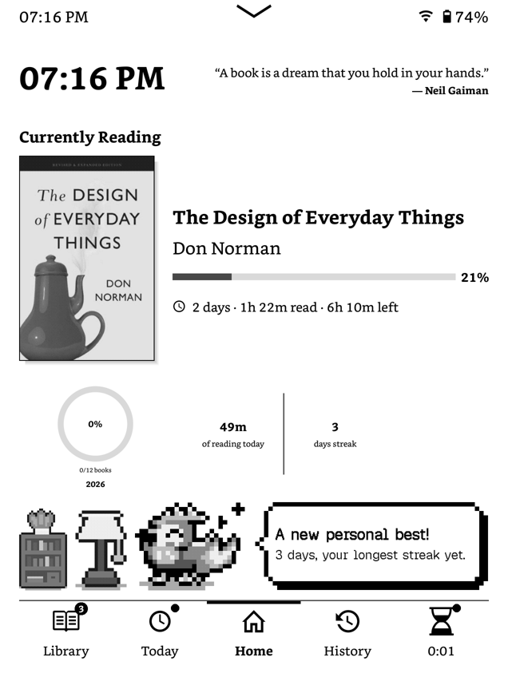
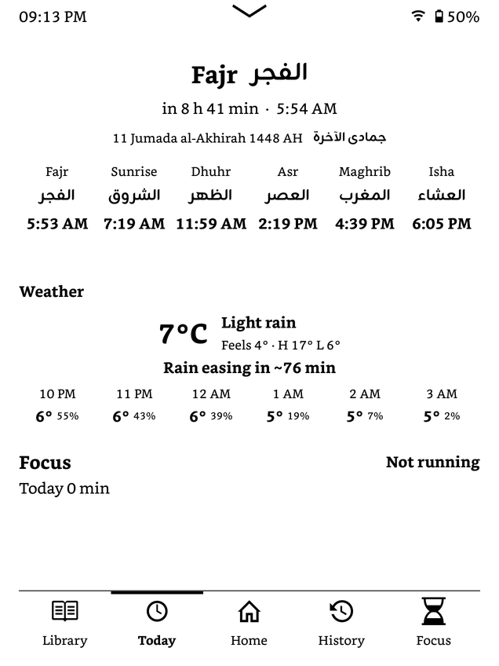
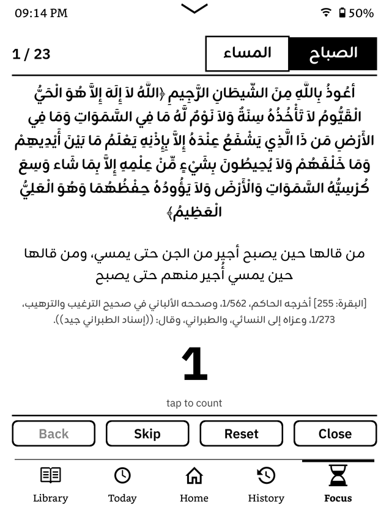

# kindle-dashboard

Prayer times, weather, a focus stopwatch and adhkar for a jailbroken Kindle Paperwhite (12th gen / PW6), as [KOReader](https://koreader.rocks) plugin modules for the [Simple UI](https://github.com/doctorhetfield-cmd/simpleui.koplugin) Home screen. It also has a lock screen with Anqa, the critter, in a mood that follows your reading.

**Simple UI is required.** This plugin adds modules and quick actions to Simple UI through its public module registry and quick-action API. It does not include Simple UI code, so this code stays MIT. Without Simple UI the plugin loads, but it shows no modules.

Inspired by [kindil](https://github.com/sharno/kindil) by sharno, a prayer-time wall dashboard for the first Kindle Paperwhite.

| Home | Today | Focus |
|---|---|---|
|  |  |  |
| **Adhkar** | **Lock screen** | |
|  |  | |

## Simple UI Home modules

Add them with Simple UI's "Add module" (group "Extras"), on any Home page or Custom Screen. Long-press a module for Simple UI's size and layout settings. The clock and the current book card are Simple UI's own modules.

- **Prayer times** (`dash_prayer`): the next prayer with its Arabic name and a countdown, the Hijri date with the Arabic month, and the 6 times with Arabic names (the next one is black). Jumu'ah on Fridays. Computed on the device (PrayTimes algorithm), checked against Aladhan to within 1 minute. Hijri date from the Umm al-Qura tables, with an offset setting for local moon sighting.
- **Weather** (`dash_weather`): from [Open-Meteo](https://open-meteo.com): now, a rain line ("Rain in ~40 min"), and the next 6 hours. Fetched in a child process, so taps never wait for the network. The result stays in memory and is fetched again every `weather_minutes`. Tap to fetch now.
- **Focus** (`dash_focus`): the running (or last) label, the running time, the time today and the weekly goal left. Tap to open the full focus stopwatch.
- **Adhkar reminder** (`dash_adhkar`): shows only while the morning or evening adhkar are due. Tap to open the adhkar screen.
- **Quick actions** `dash_stopwatch` (Focus, hourglass icon) and `dash_adhkar_open` (Adhkar): use them as a bottom-bar tab, in a Quick Actions row or in the quick-settings bar. The stopwatch and the adhkar screen show Simple UI's bars; while the stopwatch is open, the Focus tab is active.
- **E-ink friendly**: each minute only the modules whose text changed are redrawn, with a partial "ui" refresh of their own area, and a flashing refresh of that area every `full_refresh_minutes` changes. The timer stops while the device sleeps, a book is open or the Home screen is closed.

Simple UI is the start screen and the screen after a book closes (Simple UI settings).

## Other features

- **Focus stopwatch**: a full-screen stopwatch (Start and Stop, no pause) with today, week and month totals. Single sessions are kept for 12 months, then only day totals per label.
- **Stop dialog**: Stop shows the label, date, start, end and duration. Correct any of them with touch pickers, then **Save**, **Discard** (after a confirm) or **Cancel** (the session keeps running). Sessions shorter than 1 min are not saved.
- **History**: newest first. Tap a session to change its label, date, start or end, or to delete it. **+ Add past session** adds one by hand. An end time before the start time is on the next day. Times in the future or more than 12 months ago are rejected. Sessions older than 12 months (day totals) cannot be edited.
- **Idle view**: while the stopwatch runs and nobody touches it for `focus_idle_seconds`, it shows the label, the running time (h:mm:ss) and the weekly goal left, turned 90° clockwise. Only the time area is redrawn each second. A touch goes back to the stopwatch and does nothing else. While it runs, the stopwatch keeps the Kindle awake (KOReader auto-suspend paused, powerd `preventScreenSaver`); the power button still sleeps it.
- **Session labels and weekly goals**: Start asks for a label (default: Work, Uni Study, Research Work, Personal Study; the last used label is first). The stopwatch shows one row per label with the time done this week (from Monday) and the time left to its weekly goal, or "Goal met". Tap **Labels** (when the stopwatch is not running) to add, rename or remove a label and to set its goal in hours. A removed label leaves the Start list only: its past sessions keep their label and still count.
- **Anqa lock screen** while the device sleeps, unlocked with a swipe up. It is drawn at each sleep from KOReader's reading statistics: party (a book finished today), sad (no reading today), cheer (a 7-day streak or more), heart (daily goal met) or sleepy, with one line about today in Geist Pixel (Simple UI's pixel font, at a size that keeps its pixels sharp). While adhkar are due, Anqa has a tasbih.

- **Bottom bar marks**: the Focus tab shows the running time (h:mm) and a dot while focus runs and the tab of a Custom Screen with the Adhkar reminder module shows a dot while adhkar are due. They are checked each minute.
- **Arabic books** turn pages right-to-left automatically.
- **Bluetooth** (Settings tab → Bluetooth, after Network): turn Bluetooth on or off, scan, pair, connect, disconnect, and forget (hold) devices, through Amazon's `com.lab126.btfd` over lipc. No Amazon UI needed. Works with [KinAMP](https://github.com/kbarni/KinAMP) for music while reading.
- **Home folder sort**: the home folder is sorted by "last opened" (reading history).
- **Brightness and warmth**: use KOReader gestures (left edge swipe: brightness, right edge swipe: warmth). Simple UI passes edge swipes to them.

## Adhkar

Morning and evening adhkar (أذكار الصباح والمساء) from Hisn al-Muslim, stored in the plugin (`adhkardata.lua`, works offline). Morning has 23 adhkar, evening 21.

- **Open**: tap the Adhkar reminder module, the `dash_adhkar_open` quick action, or **Adhkar** in the tools (wrench) menu.
- **Default set** by the plugin's prayer times: morning from Fajr to Asr, evening from Asr to the next Fajr. **Morning** / **Evening** at the top opens the other set.
- **One dhikr per screen**: the Arabic text (its size goes down until it fits; if it still does not fit, swipe up and down), the virtue (فضل) when Hisn al-Muslim gives one, and the hadith reference. The big number is the count left.
- **Tap** anywhere on the text or the number to count one. At 0 the next dhikr shows. **Back**: previous dhikr. **Skip**: next dhikr. **Reset**: count the current dhikr again from the start. **Close**.
- **Progress** is saved in `koreader/settings/dashboard_adhkar.lua` (`morning`, `evening`: `key` = start date of the period, `index`, `left`, `done`). Reopen to continue. Morning progress starts again at each Fajr, evening progress at each Asr.
- **Reminder**: from Fajr until the morning set is done (or until Asr), the reminder module shows "أذكار الصباح". From Asr until the evening set is done (or until the next Fajr), it shows "أذكار المساء". Other times it is not shown.

Test: `TZ=America/Chicago luajit test/adhkar_test.lua`

## How it runs

KOReader runs **without the Amazon UI** (`koreader.sh --framework_stop`). This frees about 250 MB of RAM and lets KOReader own the lock screen.

- `kindle/mykindle-start.sh` starts KOReader with progress on the screen. At boot it shows a 15 s countdown: touch the screen to stay in the Amazon UI. When KOReader exits, it shows "Opening Kindle …" until the Amazon UI has drawn (about 45 s).
- `kindle/mykindle-koreader.conf` (upstart) runs the start script once per boot. Create `/mnt/us/NO_KOREADER_BOOT` to turn this off.
- `kindle/KOReader-NoUI.sh` and `kindle/kpm-koreader-launch.sh`: library tiles that start the same way.
- `kindle/mykindle-ssh.conf` and `kindle/mykindle-tailscale.conf`: SSH on localhost, reached over Tailscale (userspace networking, no log upload).
- `kindle/mykindle-firewall.conf`: loads Amazon's firewall rules. The stock rules file has an unfilled `@@SUBST_…@@` line, so the stock job loads no rules and all ports stay open.

## Requirements

- A jailbroken Kindle with KOReader, and root SSH as host `mykindle` in your SSH config.
- [Simple UI](https://github.com/doctorhetfield-cmd/simpleui.koplugin) installed and enabled (tested with 3.1.0).
- The upstart jobs need a writable root (`mntroot rw`), which `deploy.sh` does for you.

## Install

```sh
./deploy.sh
```

This copies the plugin, the fonts, the lock-screen image, the start scripts and the library launchers. It installs the upstart jobs only when they changed. Files that a running process may have open are replaced, not overwritten.

Then start KOReader from the library tile "KOReader (no Amazon UI)", or reboot.

## Settings

`koreader/settings/dashboard.lua` (all optional):

| Key | Default | Meaning |
|---|---|---|
| `lat`, `lon` | Minneapolis | Location for prayer times and weather |
| `method` | `isna` | `isna`, `mwl`, `egyptian`, `karachi`, `umm_al_qura` |
| `madhab` | `shafi` | `shafi` or `hanafi` (Asr) |
| `adjust` | none | Minutes to add per prayer, for example `{ fajr = 2, isha = -1 }` |
| `clock` | `12h` | `12h` or `24h` |
| `hijri_offset` | `0` | Days to add to the Umm al-Qura date |
| `temperature_unit` | `celsius` | `celsius` or `fahrenheit` |
| `full_refresh_minutes` | `30` | A module area gets a flashing refresh after this many minute updates |
| `weather_minutes` | `30` | Weather update interval |
| `focus_idle_seconds` | `5` | Seconds without a touch before the running stopwatch shows the idle view |

`koreader/settings/dashboard_focus.lua` holds the stopwatch data. Edit labels and goals on the device with **Labels**:

| Key | Meaning |
|---|---|
| `labels` | Ordered list of `{ name = "Work", goal_hours = 10 }`. No `goal_hours` (or 0): no goal |
| `state` | The running session: `started`, `label`. A paused session from an older version runs on from its start |
| `sessions` | Sessions of the last 12 months: `start`, `stop`, `secs`, `label`. `secs` = `stop - start`; older sessions with pauses keep their active time until their times are edited. Sessions without a label count as "No label" |
| `days` | Older sessions as `days["YYYY-MM-DD"][label] = secs` |

The daily goal of the lock screen is `dashboard_daily_goal_minutes` in `koreader/settings.reader.lua` (default 30). If the lock screen cannot be drawn, KOReader shows the quote image from `tools/quote_make.py` (run by `deploy.sh`).

## Tests

```sh
lua5.4 test/verify.lua <lat> <lon> <method> <y> <m> <d> <utc offset>
luajit test/focusstore_test.lua
```

## Credits

- Design inspired by [kindil](https://github.com/sharno/kindil).
- Prayer-time math: the PrayTimes algorithm.
- Hijri data: [hijridate](https://github.com/dralshehri/hijridate) 2.6.0 (MIT), official Umm al-Qura tables.
- Weather: [Open-Meteo](https://open-meteo.com).
- Critter "Anqa": based on "Pixel Phoenix" by [zonked](https://opengameart.org/content/pixel-phoenix) (CC0), sprite sheet in `tools/assets`. `tools/critter_phoenix.py` (run by `deploy.sh`) makes it gray for e-ink and draws its faces, crest, tail and mood symbols.
- Fonts: [IBM Plex Sans](https://github.com/IBM/plex) and [Zain](https://fonts.google.com/specimen/Zain), both SIL OFL (licenses in `dashboard.koplugin/fonts`).
- Adhkar text: [Morning-And-Evening-Adhkar-DB](https://github.com/Seen-Arabic/Morning-And-Evening-Adhkar-DB) by Seen Arabic (MIT, `ar.json` at commit 39d422f; license in `adhkardata.lua`), from the book "حصن المسلم من أذكار الكتاب والسنة" by Sa'id bin Ali bin Wahf al-Qahtani. Changes: the opening line "الحمد لله وحده…" removed (it is not a dhikr); Al-Ikhlas, Al-Falaq and An-Nas joined in one dhikr said 3 times, with the basmala, as in the book; diacritics added to the evening variants that had none; typos fixed (الْمُلْكُ, الذُّنُوبَ, نَبِيِّنَا, the evening "أمسينا وأمسى الملك لله رب العالمين"); sura and ayah numbers moved from the text to the reference; book-font artifacts and repeated reference text removed.

## License

MIT, see [LICENSE](LICENSE). The fonts keep their own SIL OFL licenses (`dashboard.koplugin/fonts`). Simple UI (GPL-3.0) is a separate plugin; this repository has none of its code.
