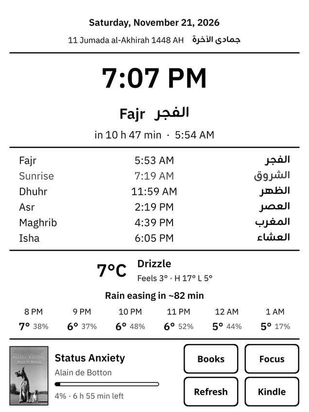
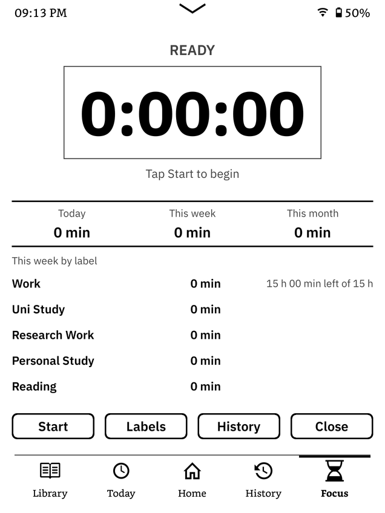

# kindle-dashboard

A desk dashboard for a jailbroken Kindle Paperwhite (12th gen / PW6), built as a [KOReader](https://koreader.rocks) plugin. It shows the clock, prayer times with Arabic names, the Hijri date, the weather, and the last book you read. It also has a focus stopwatch and a quote lock screen.

Inspired by [kindil](https://github.com/sharno/kindil) by sharno, a prayer-time wall dashboard for the first Kindle Paperwhite.

| Dashboard | Focus stopwatch | Lock screen |
|---|---|---|
|  |  |  |

## Features

- **Prayer times** computed on the device (PrayTimes algorithm), with the next prayer and a countdown. Jumu'ah on Fridays. Checked against Aladhan to within 1 minute.
- **Hijri date** from the Umm al-Qura tables, with an offset setting for local moon sighting.
- **Weather** from [Open-Meteo](https://open-meteo.com): now, a rain line ("Rain in ~40 min"), and the next 6 hours. Fetched in a child process, so taps never wait for the network.
- **Last book card**: the cover, title, author, progress and time left (from KOReader reading statistics). Tap it to continue reading.
- **Focus stopwatch**: a full-screen stopwatch with today, week and month totals. Single sessions are kept for 12 months, then only day totals.
- **Quote lock screen** while the device sleeps, unlocked with a swipe up.
- **Arabic books** turn pages right-to-left automatically.
- **E-ink friendly**: only the clock area is redrawn each minute, with a full refresh every 30 min.
- **Edge swipes** on the dashboard: left edge for brightness, right edge for warmth.

## How it runs

KOReader runs **without the Amazon UI** (`koreader.sh --framework_stop`). This frees about 250 MB of RAM and lets KOReader own the lock screen.

- `kindle/mykindle-start.sh` starts KOReader with progress on the screen. At boot it shows a 15 s countdown: touch the screen to stay in the Amazon UI. When KOReader exits, it shows "Opening Kindle …" until the Amazon UI has drawn (about 45 s).
- `kindle/mykindle-koreader.conf` (upstart) runs the start script once per boot. Create `/mnt/us/NO_KOREADER_BOOT` to turn this off.
- `kindle/KOReader-NoUI.sh` and `kindle/kpm-koreader-launch.sh`: library tiles that start the same way.
- `kindle/mykindle-ssh.conf` and `kindle/mykindle-tailscale.conf`: SSH on localhost, reached over Tailscale (userspace networking, no log upload).
- `kindle/mykindle-firewall.conf`: loads Amazon's firewall rules. The stock rules file has an unfilled `@@SUBST_…@@` line, so the stock job loads no rules and all ports stay open.

## Requirements

- A jailbroken Kindle with KOReader, and root SSH as host `mykindle` in your SSH config.
- The upstart jobs need a writable root (`mntroot rw`), which `deploy.sh` does for you.

## Install

```sh
./deploy.sh
```

This copies the plugin, the fonts, the lock-screen image, the start scripts and the library launchers. It installs the upstart jobs only when they changed. Files that a running process may have open are replaced, not overwritten.

Then start KOReader from the library tile "KOReader (no Amazon UI)", or reboot.

## Settings

`koreader/settings/dashboard.lua` (all optional):

| Key | Default | Meaning |
|---|---|---|
| `lat`, `lon` | Minneapolis | Location for prayer times and weather |
| `method` | `isna` | `isna`, `mwl`, `egyptian`, `karachi`, `umm_al_qura` |
| `madhab` | `shafi` | `shafi` or `hanafi` (Asr) |
| `adjust` | none | Minutes to add per prayer, for example `{ fajr = 2, isha = -1 }` |
| `clock` | `12h` | `12h` or `24h` |
| `hijri_offset` | `0` | Days to add to the Umm al-Qura date |
| `temperature_unit` | `celsius` | `celsius` or `fahrenheit` |
| `autostart` | `true` | Show the dashboard when KOReader starts and when a book closes |
| `full_refresh_minutes` | `30` | Full e-ink refresh interval |
| `weather_minutes` | `30` | Weather update interval |

The lock-screen quote is drawn by `tools/quote_make.py` (run by `deploy.sh`). Edit it to change the quote.

## Tests

```sh
lua5.4 test/verify.lua <lat> <lon> <method> <y> <m> <d> <utc offset>
```

## Credits

- Design inspired by [kindil](https://github.com/sharno/kindil).
- Prayer-time math: the PrayTimes algorithm.
- Hijri data: [hijridate](https://github.com/dralshehri/hijridate) 2.6.0 (MIT), official Umm al-Qura tables.
- Weather: [Open-Meteo](https://open-meteo.com).
- Fonts: [IBM Plex Sans](https://github.com/IBM/plex) and [Zain](https://fonts.google.com/specimen/Zain), both SIL OFL (licenses in `dashboard.koplugin/fonts`).

## License

MIT, see [LICENSE](LICENSE). The fonts keep their own SIL OFL licenses (`dashboard.koplugin/fonts`).
